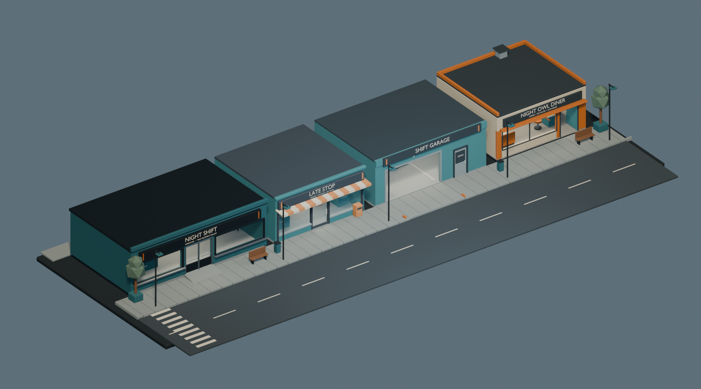
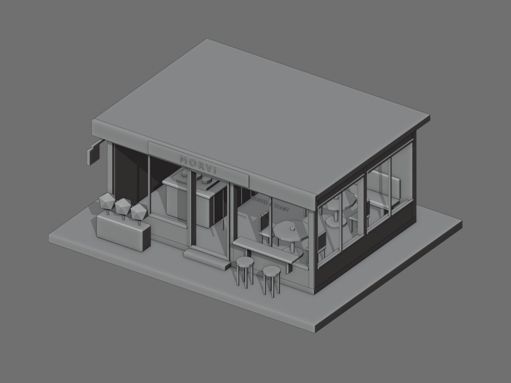

# Blender Asset Workflow — v0.4 private review draft

A compact, project-independent skill for low-poly hard-surface modeling and modular scene assembly with Blender. Native geometry first, cheap white previews next, visual and export checks before presentation.

**Status:** private repository review draft; not installed or publicly released. No license has been selected or granted by this draft. The frozen v0.1 package completed one independent fresh-context functional test; v0.2 contains narrow post-test helper corrections; v0.3 adds a runnable neutral example and conservative overlap review. Neither is represented as another independent modeling test.

Read [`skills/blender-asset-workflow/SKILL.md`](skills/blender-asset-workflow/SKILL.md). This folder is the portable skill package; repository showcase and tests are not required inputs. Requires Blender 4.3-compatible Python; the optional guard requires POSIX Python 3. No external plugins or online services are required.

## What this workflow emphasizes

**Independent QA and the numeric-pitfall table are core, not optional finishing touches.** The normal workflow is automatic: build → freeze saved artifacts → independent reviewer inspects actual pixels and reimports exports → bounded repairs → re-review → delivery. There is no routine “wait for the user to approve the next modeling stage” gate. A distinct reviewer must actually run; if the host cannot provide one, report self-check only rather than inventing independence. Platform permission prompts and authorization boundaries still apply.

- [Independent QA execution protocol](skills/blender-asset-workflow/references/independent-qa.md): builder/reviewer context separation, evidence handoff, saved-artifact checks, verdicts and bounded repair/stop conditions.
- [Numeric and evidence traps](skills/blender-asset-workflow/references/numeric-pitfalls.md): why source hashes, AABB results, polygon counts, exporter seams and “fresh process” checks can mislead.

### Platform limits

**Live RSS memory limiting works only on Linux.** It is sampled process-group monitoring, not a hard memory sandbox. The optional `guarded_run.py` timeout/process-group cleanup requires POSIX (Linux tested; macOS not tested); requesting its RSS limit on another platform fails clearly. The bounded minimal-shop runner currently requires Linux. Windows is not supported by that runner or POSIX guard. The Blender modeling guidance itself is not an assertion that every helper is cross-platform.

## Installation and first run

Requirements: an agent host that supports directory-based skills, Python 3, and Blender 4.3-compatible CLI. Blender 4.3.2 is the tested version. Git is needed only to clone; private-repository access must already be authorized. No external Blender plug-in or asset download is required.

```sh
git clone https://github.com/2409324124/blender-asset-workflow-skill.git
cd blender-asset-workflow-skill
blender --version
python3 --version
```

### Codex directory installation (Bash on Linux/macOS)

Codex's skill installer convention is `$CODEX_HOME/skills`, defaulting to `~/.codex/skills`. Copy only the portable skill folder; repository examples are run from the checkout. The commands below refuse to replace an existing skill:

```sh
dest="${CODEX_HOME:-$HOME/.codex}/skills/blender-asset-workflow"
if [ -e "$dest" ]; then printf '%s\n' "Already installed: $dest; review before updating."; exit 1; fi
mkdir -p "$(dirname "$dest")"
cp -R skills/blender-asset-workflow "$dest"
test -f "$dest/SKILL.md" && test -f "$dest/references/independent-qa.md"
```

On the next host turn, verify that `blender-asset-workflow` is discoverable and ask the host to read its `SKILL.md`. The filesystem check alone does not prove host discovery. If a different host/version uses another skills directory, follow that host's installation documentation and copy the same folder there; no universal one-click installer is claimed. This repository does not install itself.

Run the example from the repository checkout on Linux (check available RAM first; choose a fresh output directory):

```sh
python3 examples/minimal-shop/run_example.py --output ./runs/shop-001 --max-rss-mib 2048
python3 -m unittest discover -s tests -p 'test_*.py' -v
```

Open the resulting BLEND/GLB and PNGs. The runner's data checks and preview generation are **not independent visual QA**; the agent host must actually arrange the separate review described above. Change the cap for your machine; 2048 MiB is an example, not a universal safe allocation.

## Historical gun shop and street showcase



This user-selected screenshot depicts the earlier gun-shop and four-store street project that motivated this workflow. It is historical project work, **not an output of the independent generic-skill cold test**. The owner authorized this image for this private repository; future public redistribution requires a separate rights review. Only the screenshot is included, not the earlier project's models or source code.

## First independent test — frozen v0.1



An independent first-use test created the fictional **MORVI coffee & toast** café from scratch using frozen v0.1 and ordinary Blender/Python, without historical model files or the skill author's modeling guidance. The tester used Blender's frontend for the requested genuine build recording, then serialized headless checks and cheap Workbench previews. Final native/GLB comparison found 128 evaluated objects and 9,724 triangles each, with maximum per-object world-bound difference about 0.00000024 m.

The first candidate needed a staff-aisle correction; the first preview framing clipped edges and was widened before final pixel review. This is one functional result, not a universal quality guarantee or a controlled skill/no-skill comparison. The model is a white/solid static scene, with simplified equipment, no authored beauty materials, no glass panes, no architecture-code certification or engine integration test. The preview shown is the tester's final v0.1 result, **not** a rerun with v0.2.

v0.2 corrects empty-import isolation, nonfinite resource limits, descendant-termination test evidence, and camera fitting against the actual projected frame. It adds neutral regression fixtures rather than bundling the café builder or model as a required input.

## Historical scene

The selected historical screenshot appears above at the owner's request. Underlying historical models and project source are not included. MORVI remains the separate original white-preview functional-test example; it is not the main visual showcase.

## Validation
Helper regression tests use newly created neutral primitive geometry, not historical models. See `tests/RESULTS.md` for observed results and limits. Capability claims remain limited to tested behavior, not every Blender task.

## Runnable minimal shop and overlap review

```sh
python3 examples/minimal-shop/run_example.py --output ./runs/shop-001
```

[Example instructions](examples/minimal-shop/README.md) describe Linux/Blender prerequisites, adjustable resource caps, non-overwriting outputs, native/GLB checks, overall white preview, roof-off top view, and furniture close-up. The example starts from an empty scene with original neutral geometry. It does not reuse the historical showcase models.

[Overlap review guidance](skills/blender-asset-workflow/references/overlap-checks.md) distinguishes conservative AABB candidates, normal/near contacts, and exact named exceptions with reasons. It does **not** claim actual mesh penetration detection or safe/code-compliant layout. Test cases cover detectable candidates, explicit joints, touching bounds, separated objects, and invalid policies.
