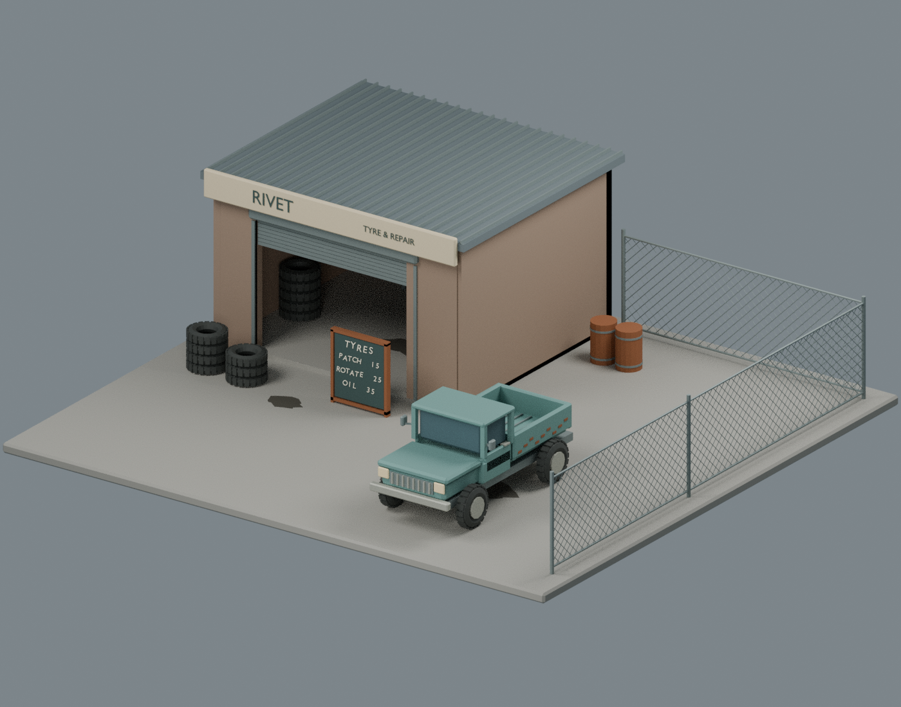

# Blender Asset Workflow

A Blender skill for low-poly hard-surface assets and modular scenes: build geometry first, inspect inexpensive white previews, then verify saved files and exports.



## What it does

- **Independent QA:** a separate reviewer inspects actual images, reopens the saved BLEND and reimports the export. If no separate reviewer runs, report self-check only.
- **Numeric traps:** hashes, polygon counts, AABB hints and successful reimports are evidence—not guarantees of resemblance or correct geometry.
- **Automatic iteration:** build → freeze → review → bounded repairs → re-review. Stop honestly at permission, input or resource limits.
- **Reusable tools:** white previews, scene inventories, overlap hints with explicit joint exceptions, and a resource-aware runner.

Read the [skill](skills/blender-asset-workflow/SKILL.md), [QA protocol](skills/blender-asset-workflow/references/independent-qa.md) and [numeric-pitfall table](skills/blender-asset-workflow/references/numeric-pitfalls.md).

## Install and run

Requires Python 3 and Blender CLI; **Linux / Blender 4.3.2** is tested. No external Blender plug-ins or model downloads are needed.

```sh
git clone https://github.com/2409324124/blender-asset-workflow-skill.git
cd blender-asset-workflow-skill
blender --version
python3 --version
```

### One-message setup for local agent sessions

Copy the relevant request into your local agent (repository access is required while private); hosted/cloud sessions may use different installation locations.

**Codex**
> Install `skills/blender-asset-workflow` from https://github.com/2409324124/blender-asset-workflow-skill into `~/.agents/skills/blender-asset-workflow`. Copy only that folder, stop if it already exists, verify skill discovery and read `SKILL.md`. Check Python availability and Blender CLI connectivity by launching a separate factory-startup background process with a 30-second timeout, running a minimal Python probe that imports `bpy` and prints the Blender version, then exiting without opening, modifying or saving any user scene. Report the actual result and any failure.

**Claude Code**
> Install `skills/blender-asset-workflow` from https://github.com/2409324124/blender-asset-workflow-skill into `~/.claude/skills/blender-asset-workflow`. Copy only that folder, stop if it already exists, verify skill discovery and read `SKILL.md`. Check Python availability and Blender CLI connectivity by launching a separate factory-startup background process with a 30-second timeout, running a minimal Python probe that imports `bpy` and prints the Blender version, then exiting without opening, modifying or saving any user scene. Report the actual result and any failure.

These are instructions for an agent, not executable shell commands or a promise of unattended authentication.

Run the original minimal shop from the checkout:

```sh
python3 examples/minimal-shop/run_example.py --output ./runs/shop-001 --max-rss-mib 2048
```

Outputs: BLEND, GLB, white overview, roof-off top view, furniture close-up and verification reports. The runner refuses existing output directories. Adjust the memory budget to your machine; arrange independent visual review separately. See [example options](examples/minimal-shop/README.md).

**Platform limits:** live RSS checks and the example runner are **Linux-only**. RSS is sampled, not a hard sandbox. Timeout/process cleanup requires POSIX; macOS is untested and Windows is unsupported by those runners.

## Validation

Current skill revision: **v0.4**. Recorded local regression run: **17 tests passed**. Independent example review: **45 meshes / 540 triangles**, matching native/GLB bounds, all three preview images inspected. These are specific local checks, not hosted CI or a universal quality certificate.

```sh
python3 -m unittest discover -s tests -p 'test_*.py' -v
```

See [test evidence](tests/RESULTS.md) and [release notes](RELEASE-NOTES.md). AABB hints are not exact mesh-collision checks; target-engine integration, character sculpting and production rigging are outside this validation.

## License and showcases

Code, skill and maintained text: **[GPL-3.0-only](LICENSE)**. Showcase images are the owner's stated original work and are separately scoped—not automatically GPL. See [license scope](LICENSING.md) and [image provenance](PROVENANCE.md).

## Further details

### Discovery and installation scope

The prompts above use personal installation directories. For project-only use, copy the same folder to `.agents/skills/blender-asset-workflow` (Codex) or `.claude/skills/blender-asset-workflow` (Claude Code). Do not copy showcase images or example outputs into the skill directory.

Codex discovers skills automatically; restart if the new skill is not listed. Claude Code also discovers skills automatically; if its top-level skills directory was created during an existing session, run `/reload-skills`. A file copy is not proof of discovery: ask the host to list/read the skill before using it. Current host references: [Codex skills](https://learn.chatgpt.com/docs/build-skills), [Claude Code skills](https://code.claude.com/docs/en/skills).

### What independent review means

The builder supplies saved artifacts and an evidence handoff; the reviewer uses a separate reasoning context rather than trusting the builder's summary. Review includes actual preview pixels, reopened native geometry and reimported exports, with findings tied to artifacts. A fresh Blender process alone does not create independent reasoning. Repairs are bounded by an explicit budget and require re-review; unresolved failures are reported instead of silently passed.

### Reading the numbers

The overlap helper reports conservative AABB candidates, contact/near-contact pairs and precisely named allowed joints. It does not compute an exact mesh collision verdict. Zero candidates does not prove a scene has no defects. Source hashes help establish file identity, not correct geometry copying; triangle counts do not measure resemblance; matching native/GLB bounds do not establish engine shading or split-normal correctness. The [numeric-pitfall table](skills/blender-asset-workflow/references/numeric-pitfalls.md) explains these and other traps.

### Historical examples

The RIVET lead image is a visual showcase, not by itself a QA report. The original MORVI café white preview records the frozen-v0.1 independent functional test, which required aisle and framing corrections. The earlier NIGHT SHIFT street image is historical project work, not a generic-skill cold-test output. Their sources are listed in [PROVENANCE.md](PROVENANCE.md); scene/model files are not bundled as required skill inputs.

