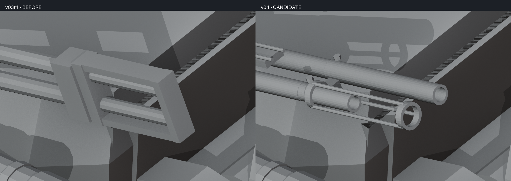
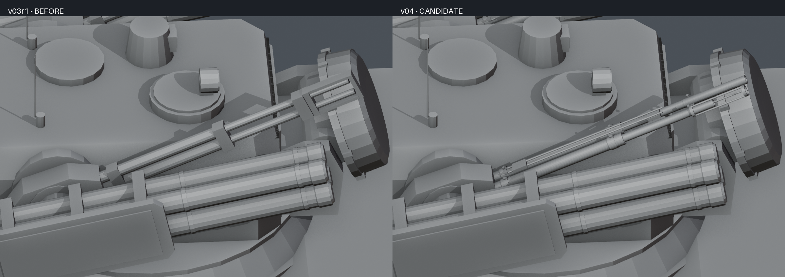
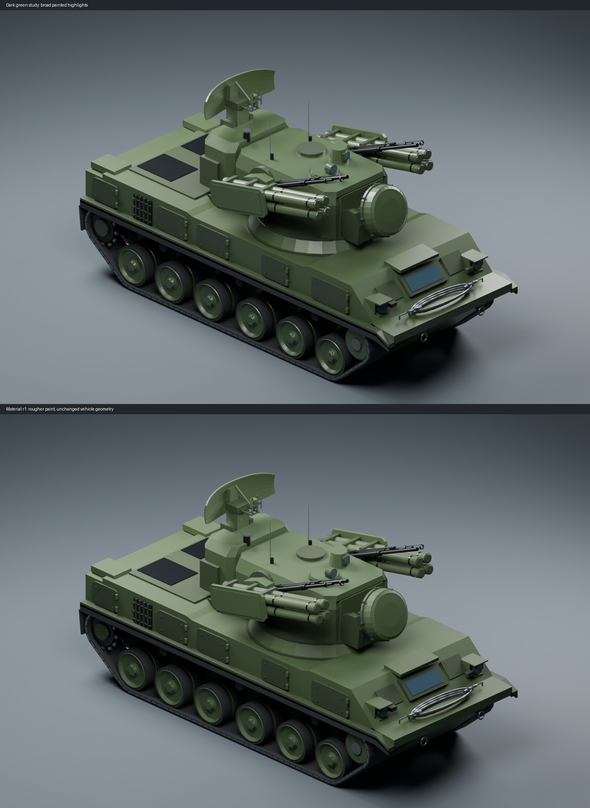
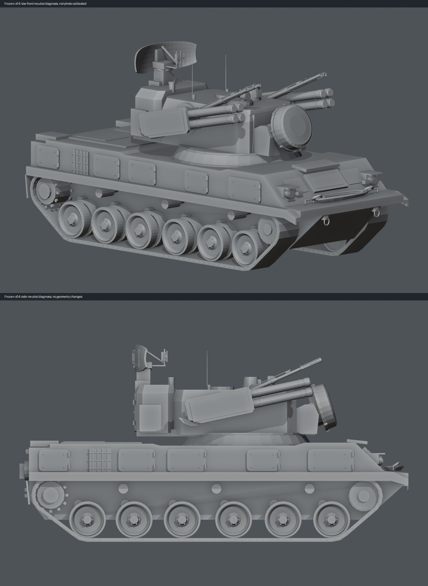

# Tunguska: a partial refinement case, not a finished realism benchmark

This case records a procedural, photo-approximate 2K22M/2S6M exterior study made with Blender 4.3.2. It illustrates both useful local repairs and an important failure: **valid saved files and an improved small part did not produce an accepted whole-vehicle surface/finish**.

After earlier local approval and delivery, the user rejected the overall appearance as neither convincing field equipment nor parade equipment and identified many problematic surfaces. That later feedback reopens the visual work. This document does not relabel the rejected result as a successful realistic asset.

For the portable method, see [armored vehicle modeling and refinement](../../skills/blender-asset-workflow/references/armored-vehicles.md). The guide is a method distilled from the iteration, not a claim that every recommended diagnostic was performed on this model.

## What was built and kept separate

The model used semantic hull, turret, running-gear, sensor and side-mount assemblies, with separate articulation roots. Geometry and presentation revisions were saved separately. One worker handled geometry, one handled materials/lights, and another reviewed bounded changes. Native files and actual GLB imports were checked; the evidence summaries identify the saved artifacts but are not substitutes for them.

Reference photographs were uncalibrated perspective views and included different exhibition contexts. No exact real-world dimensions, manufacturing fidelity or functional behavior were established. A model-generated three-view SVG was useful for internal consistency only: it was not an independently measured blueprint.

## Iteration and what its evidence supports

| Stage | Actual change or observation | Valid conclusion | Remaining limit |
| --- | --- | --- | --- |
| Initial blockout | Hull, turret, wheels/tracks, sensors and exterior mounts | A saved, reviewable exterior existed | Proportions and many surfaces remained approximate |
| v02/v03 | Turret/radar outline work, dished wheel hubs, front fittings and hatch hinges | Specific local appearance improved in inspected views | More detail did not establish correct armor planes or the whole silhouette |
| v03r1 | Thin tow-cable placeholder changed to thicker multi-loop lay | Bounded tow-cable review passed | Cabin/nose, tracks, hatches and mounting structures remained simplified |
| v04 | Two side cannon exterior meshes refined: stepped paired tubes, connectors and an open end frame instead of an obstructing solid bridge | Bounded external-opening/shape review passed; fixed paired-tube identity retained | Shallow visual apertures, not an internal or engineering reconstruction |
| First material set | Pale olive studio presentation | Same geometry could be presented and exported consistently | User requested a more convincing military/parade finish |
| Dark-green study | Darker paint; metal/rubber material separation | A material-direction preview existed | Specific earlier parade photo was not identified; no claim of exact color/marking match |
| Material r1 | Reduced painted-surface coat/specular/metalness and increased roughness | Near-white broad painted highlights visibly weakened under fixed lights | Overall vehicle still rejected; surface-construction diagnosis remained open |

The model retained **16 mesh objects**. The checked GLB triangulation changed from **55,404 triangles in v03r1** to **62,660 in v04**. These are particular artifact statistics, not quality targets. The [recorded evidence summary](tunguska-evidence.json) lists the v04 counts. The v03r1 count comes from the historical narrative; the v03r1 GLB is unavailable for independent comparison.

## Local repair: fix the missing shape, not its color

The old muzzle/end-frame study had a solid crosspiece obscuring the visible ends. A black painted circle would not have repaired the silhouette or opening. The replacement introduced visible rims/recesses and an open frame, then regenerated close-up and overall views without changing the other assemblies or their pivots.

These pictures support a limited external-shape improvement. They do not prove exact reference dimensions, joint clearances, internal construction or whole-vehicle realism. The lesson generalizes to sensor supports, lamp guards and other open exterior fittings: visible negative space must have appropriate geometry, not just a dark material.

## Material repair: same camera, distinct finish question

The color study changed shader settings while preserving the source vehicle geometry. Under the same studio lighting, the first dark-green version produced conspicuous pale bands on the turret collar, rear deck and painted side tubes. Lower coat/specular response and higher paint roughness reduced those bands in r1.

This is an iteration image, not an approved beauty showcase. The coat/roughness change did not demonstrate corrected armor construction. A pleasing palette, stronger AO or extra fittings cannot repair an incorrect plate transition. The specific parade reference was still unresolved; no insignia or exact official paint code was invented.

The saved native material includes procedural roughness variation. GLB retained supported material information but was **not** independently certified visually equivalent to the Cycles shader. Geometry/bounds checks cannot establish that equivalence.

## What the file checks actually established

The v03r1-to-v04 preservation comparison reported changes only to the two side cannon meshes; object identities and transforms elsewhere were preserved. For each presentation variant, reopened vehicle mesh coordinates, face indices, parents and world matrices were compared against frozen v04. The actual GLBs were imported into empty scenes and checked for matching vehicle inventory/bounds, with no studio floor included.

The [JSON summary](tunguska-evidence.json) records source/presentation hashes and selected results. It is extracted from the actual local checks, **not a rerun included with this PR**. Native/GLB models and the full project build scripts are not bundled here. A reader can identify the artifacts by hash but cannot reproduce the model checks from the documentation and images alone.

These checks establish preservation and export integrity. They do not establish:

- Correct armor-plane slopes, curve segmentation, normal treatment or reference resemblance.
- A visually correct running-gear/track design merely because the bounding box matches.
- Independent approval of all later geometry/material versions from an earlier local pass.
- Operational articulation, mechanical clearances or game-engine readiness.

## Read-only diagnosis after the rejection

Two separate reviews inspected saved-scene data and low-front/side neutral pixels in addition to the material views. The inventory found all 16 vehicle meshes had **zero smooth-shaded polygons**, no custom normals and no modifiers. This identifies all-flat shading, **not reversed normals** and not a reason to smooth the entire vehicle. Flat armor planes should retain their hard boundaries. Curve-side shading and silhouette sampling need separate tests.

The low views make problems easier to see than the earlier high-angle beauty cameras, but are not calibrated matches to a photograph. Workbench neutral images versus Cycles material images also change renderer and lighting: they help reveal the same underlying construction, but **are not a strict single-variable shader experiment**.

| Region | Observed limitation in this case | Required caution / next test |
| --- | --- | --- |
| Front observation area and lamp guards | Broad blue-black rectangular panel, thick visor and generic boxes simplify the exterior partition | A reference cover is open: select a coherent open/closed state, not a permanent hole inferred from that one view |
| Turret and collar | Uniform eight-corner loft/shoulder and segmented lower collar read as construction primitives | Validate plate transitions individually; isolate curved-side shading before changing silhouette samples |
| Tracking-radar cover | Nested cylinder/frustum rim steps and faceted outer contour | Review rim profile, not an assumed spherical dome; the central face may legitimately be planar |
| Side hatches/grilles | Repeated rectangles/bolts miss varied outlines and attachment rhythm | Match the same visible side; do not infer the hidden side by symmetry |
| Tracks/wheels | Band-like track with shallow pads; segmented curved wheel surfaces | First demonstrate a short decorative plate/link sample and selective curved-side treatment, not a functional mechanism |
| Glass and underbody light | Saved glass shader has transmission weight 0; dark running gear loses readability | Do not enable full transparency without a coherent interior; test glass appearance and fill light separately after shape issues |

These are observed simplifications and proposed tests, not completed repairs. Source views include [front-oblique TankBiathlon -30](https://commons.wikimedia.org/wiki/File:2S6M_combat_vehicle_2K22M_Tunguska-M_-_TankBiathlon14part2-30.jpg) and [side TankBiathlon -26](https://commons.wikimedia.org/wiki/File:2S6M_combat_vehicle_2K22M_Tunguska-M_-_TankBiathlon14part2-26.jpg), credited on Commons to Vitaly V. Kuzmin, photographed 28 June 2014. Neither has been established as the user's requested parade reference; variant/state/camera differences prevent direct dimensional measurement.

## Proposed repair sequence — not yet implemented

1. On a separate diagnostic copy, keep geometry, camera, Cycles materials and lights fixed; change only selected curved-side shading and hard-boundary treatment on a radar rim, collar and wheel sample. Inspect exactly the same crop. If the silhouette still facets, test additional curve samples separately.
2. Reconstruct the visible front observation/lamp-guard partition and radar rim from one coherent reference variant and cover state. Preserve a justified planar radar face; do not indiscriminately round it.
3. Demonstrate a short decorative track-plate sample and correct same-side hatch/grille outlines before propagating changes. More screws are not the next quality gate.
4. Only then test glass appearance, subtle paint microstructure and underbody fill independently. Stop repeating global green/roughness adjustments to mask shape issues.
5. Re-review whole-vehicle resemblance and record integrity checks separately. One geometry writer owns the approved scope; no baseline overwrites or parallel competing scene edits.

This is a work list, not a claim that those repairs are already implemented or that all the symptoms share one cause.

## Sources, images and rights

All four bundled images show only this project's procedurally generated model renders, not pixels from real-vehicle photographs. The comparison PNGs were copied from the geometry iteration; the material sheet combines the two rendered front views; the shape sheet combines two read-only neutral diagnostics. They are separately scoped as case/showcase images under [the repository's existing image policy](../../LICENSING.md), not automatically GPL-licensed output. File hashes and dimensions are in the evidence summary.

Historical reference filenames included the Saint Petersburg museum pic1/pic2, the TankBiathlon14part2-25 through -30 series, and a MAKS-2011 side view. This is an inventory, **not verified photographer attribution or a license notice**. Those photographs are not uploaded in this PR. The two Commons pages linked above confirm their photographer/date and display attribution/share-alike conditions; consult their current notices for precise reuse terms. The remaining photo-source/license mappings and the requested parade photo remain unresolved. The method requires recording those before redistribution; do not guess a public-domain or Creative Commons license from a filename.

Only exterior-art methodology is documented. No functional weapon details or manufacturing data are supplied.

A subsequent [fixed-camera experiment](../experiments/surface-ablation.md) reopened the frozen exterior, tested selected wheel surfaces on local copies, and compared native and exported renders. It leaves the historical whole-vehicle rejection open.
