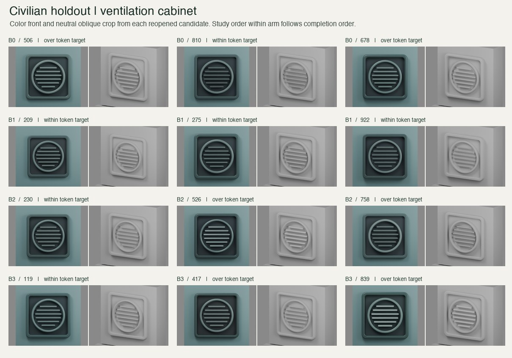

# Four-arm isolated agent study

**All four arms produced reviewable candidates. The baseline and the geometry-plus-surface pack received the same total blind score, 71/72, across the nine primary submissions per arm.** B1 scored 66/72 and B2 scored 68/72. Every civilian submission received 8/8. A 120,000-token target left 26 of 36 primary sessions within budget. These three narrow revisions support optional experimentation with the helpers. They provide no demonstrated cross-task advantage for default routing.

The unit is a fresh model session producing one additive exterior revision of a frozen Blender asset. Each task has a frozen baseline crop and a separate, original front-view design sketch. The sketches define illustrative targets. They do not establish historical accuracy. Each builder receives the same inputs within its task. Only the skill pack changes across arms.

| Arm | Files available in the trial workspace |
| --- | --- |
| B0 | Complete `skills/blender-asset-workflow` tree from `d84ca8355ca558893cff7c16712a5909033ec549` |
| B1 | Same subtree from `037f540451a6e897d5629af28bc9a15f28e0384e` |
| B2 | B1 plus the section-loft helper, parametric-surfaces reference and entry-point routing |
| B3 | B2 plus the surface-studio helper, surface-presentation reference and entry-point routing |

| Task | Requested visible change | Frozen subject |
| --- | --- | --- |
| Side skirt | Three broad cosmetic covers, narrow joints, shaped lower corners and a restrained upper edge | Existing T-90M exterior |
| Wheel cap | Continuous perimeter lip, inset band and softly crowned center | Existing Tunguska exterior |
| Ventilation cabinet | Rounded square bezel, circular surround and six shaped slats against a dark backing | New freestanding civilian display cabinet with a blank face, created independently for this study |

## Observed results

The supervised run ledger contains 36 primary sessions and 4 superseded pilots. Timing runs from builder launch through the terminal CLI event and process exit. It excludes offline host rendering and scoring. The hosted service exposed token counts, with no monetary amount or immutable model build ID. The [per-session ledger](agent-comparison/runs.csv) retains token components, elapsed seconds, tool calls, submission/candidate digests, correction counts, four blind grades and over-budget outcomes.

| Arm | Reopened / assigned | Within token target | Median total tokens | Median uncached input | Median output | Median seconds | Median tool calls |
| --- | ---: | ---: | ---: | ---: | ---: | ---: | ---: |
| B0 | 9/9 | 7/9 | 77,234 | 15,362 | 1,842 | 53.8 | 3 |
| B1 | 9/9 | 9/9 | 98,405 | 17,531 | 1,846 | 54.2 | 4 |
| B2 | 9/9 | 4/9 | 133,407 | 15,969 | 2,044 | 59.4 | 5 |
| B3 | 9/9 | 6/9 | 112,321 | 22,830 | 2,114 | 61.5 | 4 |

Total tokens include cached input. Uncached input and generated output are shown separately. Reasoning tokens are included in the output total. Medians use all completed primary sessions.

| Task | B0 | B1 | B2 | B3 |
| --- | --- | --- | --- | --- |
| Side skirt | 8, 8, 8 | 7, 8, 7 | 8†, 7†, 7† | 8, 8, 8 |
| Wheel cap | 7, 8, 8 | 7, 6, 7 | 8, 7, 7 | 8†, 7, 8 |
| Civilian cabinet | 8†, 8, 8† | 8, 8, 8 | 8, 8†, 8† | 8, 8†, 8† |

Cells list each session’s blind total out of eight, ordered by attempt within arm and task. † marks a session exceeding the common token target. Omitting those scores gives the budget-compliant comparison. The [reviewer’s frozen notes](agent-comparison/reviewer-notes.md) link each anonymous ID to a concrete feature or visual limitation.




The side-skirt target separated revisions that modeled a visible upper edge from those where it disappeared into the existing bevel. B0 and B3 both met all four criteria in all three repetitions. All three B2 side-skirt runs exceeded the token target, leaving no budget-compliant B2 observation on that task. On the hub, the strongest visible differences concerned a broad disc or a hard shoulder where the target specified a small, gently crowned center. B0 and B3 each received two scores of 8 and one of 7. The twelve primary civilian fronts all met the rubric. The blind notes describe differences in brightness and bezel size, but give no basis for ranking those four arms on the held-out cabinet.

The primary sessions consumed 4,057,360 reported tokens, including 3,268,096 cached input, 711,995 uncached input and 77,269 output tokens. The four superseded pilots consumed another 436,948. The largest primary session took 96.22 seconds, and no primary session requested more than seven tools. Two B1 wheel-cap sessions made one local mesh-generation correction apiece. The remaining 34 primary sessions made zero observed mesh-generation corrections. There were zero post-render builder repairs by design. All 40 saved files reopened. An object-by-object fingerprint check found zero changed or missing original objects, comparing object type, parent, world transform, collection memberships, mesh vertices, polygon indices, per-face material assignments and material-slot names. The check covered 157 original objects on the skirt task, 26 on the wheel task and four on the civilian task.

The CLI traces show a section-loft import in five of nine B2 submissions and five of nine B3 submissions. All nine primary B3 builders requested the surface-presentation reference. The builder had no Blender process, so this experiment measures access to guidance and the standard-library geometry helper, with host-applied PBR values. A direct comparison of builder-operated studio lighting requires separate evidence.

## Execution and review protocol

- Run the same CLI release and model selector (`gpt-6.2-sol`, low reasoning), with a fresh ephemeral session and new writable directory for each sample. Disable user config, model memory, external apps, web search and multi-agent delegation. Baseline geometry and decoded input pixels stay frozen. A treatment snapshot is a hash of a sorted manifest of file SHA-256 digests. The hosted model selector does not expose an immutable weight build.
- Supply two images and the task prompt. The builder has a shell and the complete assigned skill pack. It writes indexed mesh vertices, faces and simple PBR parameters into `mesh.json`. It may construct vertices with the pack's pure-Python helpers. Blender runs in the host harness after submission. This tests generation of a bounded exterior edit. Builder-operated Blender, native studio-helper operation and a full render-feedback repair loop require a separate study.
- Request a 120,000 input-plus-output token allowance, at most eight builder tool requests, a 180-second wall limit and one local validation correction. The supervisor halts at the first observed excess tool request or at deadline. The CLI reports cumulative usage only when a turn completes. Token compliance is audited after completion. A stopped session with missing usage stays missing. Cold and cached input are distinguished. Shell subcommands inside one tool request count as one request.
- Install accepted meshes on the original in local Blender 4.5.16 LTS. Reopen the saved candidate in a new Blender process. Render a color front crop, a neutral oblique crop and a wider color context at fixed camera, exposure, lights, resolution, CPU samples and thread count. Each trial has the same allowed region, additive edit and postprocessing for its task. The supervisor rejects invalid numeric ranges and oversized or malformed mesh data. Failed, time-limited and over-budget results stay in the run ledger.
- For visual review, hide the arm and trial labels. Present the sketch, source and randomly ordered candidate triplets to a reviewer who did not build the models. Record visible match, depth cues, material separation, silhouette fit, distracting artifacts, regressions and ties. Distinguish independent agent review from human expert sign-off. Counts, tokens and elapsed time describe execution and cannot substitute for visual judgments.
- Target three independent repetitions per arm per task (36 sessions). Report the actual number of sessions and eligible outputs for each cell. This small, single-host experiment supports descriptive comparison only. Report missing rows and failed candidates separately from completed visual comparisons. Private baseline pixels, models, archive source and raw agent traces stay outside this repository.

### Reproduce the builder inputs

The [protocol record](agent-comparison/protocol.json) contains the prompt hashes, image and pack digests, and budget. The civilian and hub suffixes are exact. The public skirt suffix uses relative proportions. Full-precision figures and the matched camera anchors for the private sources stay in the restricted local record. Append the appropriate suffix to the [common builder prompt](agent-comparison/builder-prompt.txt). The [civilian baseline](agent-comparison/vent-baseline.png) and [original target sketch](agent-comparison/vent-target.png) are the two original civilian input images. The privately held vehicle crops are access-controlled. Use the Blender asset revision and licensed local copies for an exact replay of those tasks.

`rebuild_pack.py` reconstructs each arm from its Git base, the candidate files in this checkout, and a small reverse patch for the exact candidate revision. It validates the hash of every file before exposing the pack. Use a new directory for each run. For example, with `trial` as a new directory in the current shell:

```sh
study=docs/experiments/agent-comparison
mkdir trial
python3 "$study/rebuild_pack.py" B2 trial/skill
cp "$study/vent-baseline.png" trial/baseline.png
cp "$study/vent-target.png" trial/sketch.png
python3 - "$study" > trial-prompt.txt <<'PY'
from pathlib import Path
import json, sys
study = Path(sys.argv[1])
sys.stdout.write((study / 'builder-prompt.txt').read_text())
sys.stdout.write(json.loads((study / 'protocol.json').read_text())['task_suffix']['vent'])
PY
codex --no-daemon -a never exec --ephemeral --ignore-user-config --ignore-rules \
  --skip-git-repo-check --json --color never --disable apps --disable memories \
  --disable multi_agent --enable skip_host_skill_discovery -m gpt-6.2-sol \
  -c 'model_reasoning_effort="low"' -c 'web_search="disabled"' \
  -s workspace-write -C "$PWD/trial" -i "$PWD/trial/baseline.png" \
  -i "$PWD/trial/sketch.png" - < trial-prompt.txt
```

The command illustrates one builder invocation. The study supervisor measured elapsed time, stopped on excess tool requests and retained the terminal JSON usage event. To compare new runs, apply those same stop rules. The sketch, brief and constrained mesh interface describe a scale-model cosmetic exercise. They cannot establish that the subject matches a particular real vehicle variant.

### Input handling and deviations

An initial B3 pack picked up a geometry-helper boundary fix and an extra sentence about contour scaling between the B2 and B3 snapshots. Four sessions received that pack. They remain in the ledger as superseded pilots. The corrected B3 uses the B2 geometry files byte-for-byte. Replacement sessions use the same brief and limits. The pack reconstruction check covers all four primary arms. The shipped helpers also correct the outgoing tangent at floating-point corner boundaries and reject competing or dangling PNG destinations. The reverse patch restores the exact trial version.

The first 10 vehicle and 12 civilian inputs included a Blender source-path text chunk. Later copies removed PNG text and EXIF while preserving every decoded RGB pixel. The ledger records the input variant, and the protocol records the file and pixel digests.

A public [civilian replay script](agent-comparison/replay_vent.py) rebuilds the four-object enclosure, installs a builder's JSON and reproduces the host camera, materials and lighting. Run the `build` and `render` operations in separate Blender processes:

```sh
blender -b -Y --factory-startup --python-exit-code 1 -P "$study/replay_vent.py" -- \
  build replay-candidate --mesh trial/mesh.json
blender -b -Y replay-candidate/candidate.blend --python-exit-code 1 \
  -P "$study/replay_vent.py" -- render replay-images
```

Omit `--mesh` to rebuild the blank fixture. All three rendered views of both the blank fixture and a B1 submission were compared with the original host output. The largest difference was one 8-bit channel level. The stored civilian input remains the exact pixel reference for a new builder run.

### Blind review criteria

The numerical rubric was set after generation began and before the reviewer scored any boards. Each criterion receives 0 (missing or visibly fails), 1 (present with a clear deviation), or 2 (meets the target). One independent agent reviewed anonymized boards. That reviewer contributed to the geometry helper and did not generate the trial submissions. Human expert sign-off is outstanding. The vehicle reviewer received only the original illustrative target and two local neutral-gray crops. Paint and whole-vehicle appearance were outside that review. The civilian reviewer also saw paint and context.

| Task | Four criteria, in score order |
| --- | --- |
| Side skirt | Three broad faces in proportion; narrow legible joints; shaped lower corners; restrained top edge and visually seated fit in the second view |
| Wheel cap | Continuous circular outer lip; recessed inner band; distinct shallow center crown; convincing depth and natural transition in the oblique view |
| Civilian cabinet | Rounded bezel and circular opening in proportion; six shaped slats with appropriate lengths and margins; visible depth and occlusion in the oblique view; paint and dark backing separable without visible clipping |

Builder sessions had fresh context and separate files. They shared a hosted account and provider-side prompt caching. The queues interleaved arms with at most two active builders. Replacement sessions ran later. Cache warmth, execution order and host load can affect cost and duration. The small sample and frequent ceiling scores limit what a one-point difference establishes.
