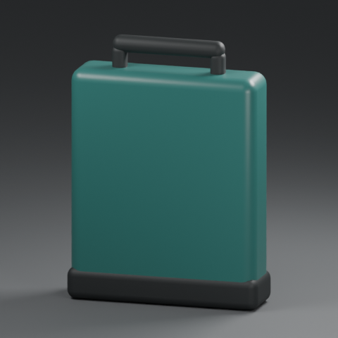
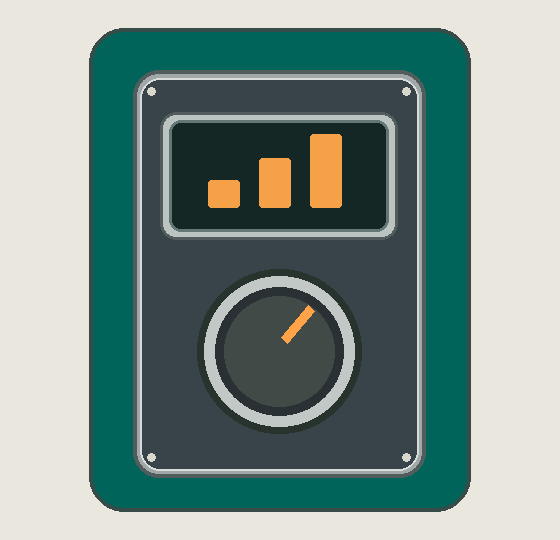
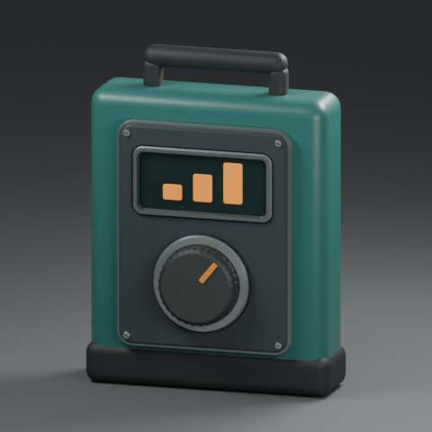
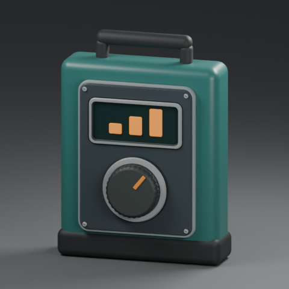
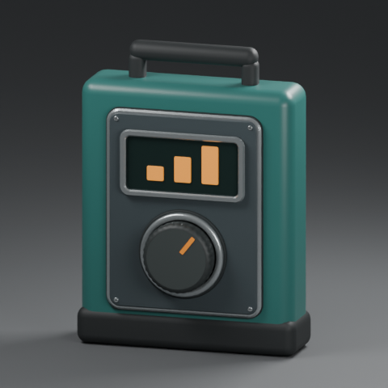
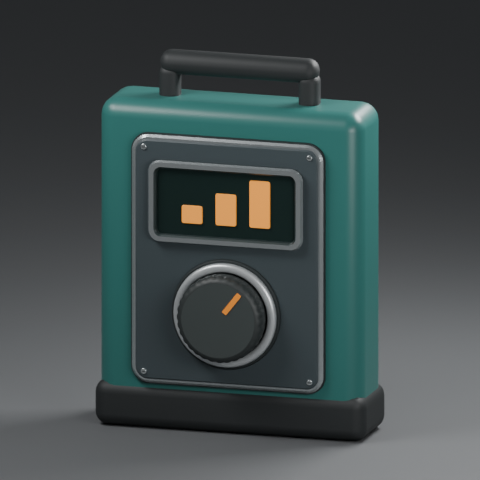

# Two builders revise an industrial meter after seeing their own render

Both builders delivered a front-panel insert, saw an actual render of their saved Blender model, and changed its materials. A reviewer scored the final B1 image **9/10** and B3 **10/10**. The one-point difference came from how the selector collar reflected the light. Each arm had one builder on one original civilian task.

| Shared blank meter | Original front-elevation design |
| --- | --- |
|  |  |

The brief specified an insert footprint of 1.56 × 1.99, an upper recessed display with three ascending amber bars sharing a baseline, and a lower dark rotary selector with a metal collar and an amber pointer. The sketch sets the component layout. The identical studio in both arms sets the lighting. [Initial prompt](agent-feedback/initial-prompt.txt) · [Feedback prompt](agent-feedback/feedback-prompt.txt)

## Actual Blender feedback

| Arm | First saved model, reopened | Revised model, reopened |
| --- | --- | --- |
| B1 |  |  |
| B3 |  |  |

- **B1** observed that the collar appeared muted compared with the sketch. It lightened the two shared metal materials, increased their roughness slightly and reduced their metallic factors. This affected the outer perimeter, display trim and selector collar together.
- **B3** observed a thin amber reflection along the upper inside edge of the window and wanted a brighter collar. It assigned the inner display bevel to the existing dark liner and gave the collar a separate, brighter satin material. The upper edge observation is the builder's interpretation of its render.
- Both submissions kept their first-pass geometry. B1 added 19 objects and B3 added 20. In all four saved files, the added part bounds satisfied the specified volume. Independent file reopening found no changes to the checked original object transforms, mesh geometry, material factors, camera scale or area-light parameters.
- The fraction of image pixels changing by more than eight levels in any RGB channel was 4.736% for B1 and 1.456% for B3. These figures describe the extent of the two material edits. Only final images received blind quality scores.

## Blind review

A separate agent received the blank meter, target and the two final 480 × 480 images under randomly assigned names. It returned scores before the operator revealed the mapping. The five criteria had been fixed before either submission was complete. Each criterion earned 0 for a missing or failing feature, 1 for a visible deviation and 2 for a match.

| Final image | Softened plate and thin metal perimeter | Three ascending bars in a wide display | Lower knob, collar and index | Seated components in the oblique view | Distinct finish and highlights | Total |
| --- | ---: | ---: | ---: | ---: | ---: | ---: |
| B1, Quartz | 2 | 2 | 2 | 2 | 1 | 9 |
| B3, Harbor | 2 | 2 | 2 | 2 | 2 | 10 |

The reviewer could distinguish the screen, three columns and one-o'clock pointer in both renders. In B3 the metal collar's narrow upper and right highlights fall into shadow at the lower right. In B1 the collar appears broader and more uniformly light gray. Both knob edges showed small visible steps. The task supports preserving highlights when they communicate shape and finish. A single score difference cannot establish a general advantage in quality, cost or speed.

## Controls, tokens and elapsed time

Each builder started a new Codex CLI 0.171.0-alpha.13 session with gpt-6.2-sol, low reasoning effort and a separate working directory. Each received the same two metadata-cleaned images and prompt. Both used the exact frozen B1 and B3 packs from the [main comparison](agent-comparison.md), with ordinary Blender Python geometry and shader authoring available. B1 read the baseline skill. B3 also read the surface and parametric references. Both wrote their own geometry and material routines.

The operator audited each script, ran it in Blender 4.5.16 LTS, saved a native file, then rendered the file in a new Blender process. Each original builder session resumed with its own real first render attached, the same feedback prompt and one opportunity to revise. The operator repeated the save, reopen, render and inspection for each final script. This design exercised full in-memory Blender construction with host-mediated feedback. Direct control of a running Blender session and independent builder-controlled cameras were outside scope.

Both turns had a maximum of eight tool requests and 180 seconds per turn. Both builders completed within those limits. Input tokens include cached input. The CLI's resumed totals accumulate across both turns. Feedback figures below are increments, checked against the session's cumulative usage record.

| Arm and turn | Tool requests | Input tokens | Cached input | Output tokens | CLI wall seconds |
| --- | ---: | ---: | ---: | ---: | ---: |
| B1 first | 4 | 96,852 | 74,368 | 3,579 | 93.54 |
| B1 feedback | 2 | 76,240 | 74,240 | 439 | 23.64 |
| B3 first | 5 | 98,646 | 61,952 | 3,259 | 82.00 |
| B3 feedback | 2 | 77,538 | 57,728 | 479 | 25.54 |

| Arm | Total input + output | CLI wall | Host Blender | Operator, approval and queue intervals | Elapsed through final inspection |
| --- | ---: | ---: | ---: | ---: | ---: |
| B1 | 177,110 | 117.18 s | 7.99 s | 65.12 s | 190.29 s |
| B3 | 179,922 | 107.53 s | 8.05 s | 76.75 s | 192.34 s |

CLI wall time includes provider and local tool waiting. Host Blender time covers both builds, two renders and two independent file comparisons. End-to-end time starts when each first CLI turn launches, includes operator and approval waits, and stops after that arm's final Blender inspection. Fixture preparation, later blind review and reporting are outside that interval. Both arms shared a machine and account and ran concurrently. Their different cache hits, individual submissions and overlapping host work limit timing comparisons. Token counts cover the builders only. [Raw measurements, hashes and saved-file checks](agent-feedback/evidence.json)

## Replay a saved submission

The [fixture](agent-feedback/fixture.py), [B1 final builder](agent-feedback/B1.py) and [B3 final builder](agent-feedback/B3.py) are independent public sources. From this repository's root, use a new output directory and keep the save and render in separate Blender processes.

```sh
study=docs/experiments/agent-feedback
mkdir replay-meter
blender -b -Y --factory-startup -t 4 --python-exit-code 1 -P "$study/fixture.py" -- \
  build replay-meter/B3.blend --builder "$study/B3.py"
blender -b -Y replay-meter/B3.blend -t 4 --python-exit-code 1 -P "$study/fixture.py" -- \
  render replay-meter/B3.png
```

Use `B1.py` to replay B1. Omit `--builder` to recreate the shared baseline. To reconstruct the exact first-pass sources, copy both final scripts to a fresh directory and apply the [first-pass restoration patch](agent-feedback/restore-first.patch) there with `patch -p0`. The [saved-file comparison](agent-feedback/inspect_candidate.py) takes the baseline blend, candidate blend and a new JSON output path after Blender's `--`. The published PNGs were cleaned with the skill's PNG metadata helper. Compare the listed PNG hashes after applying the same cleaning on the same runtime.
