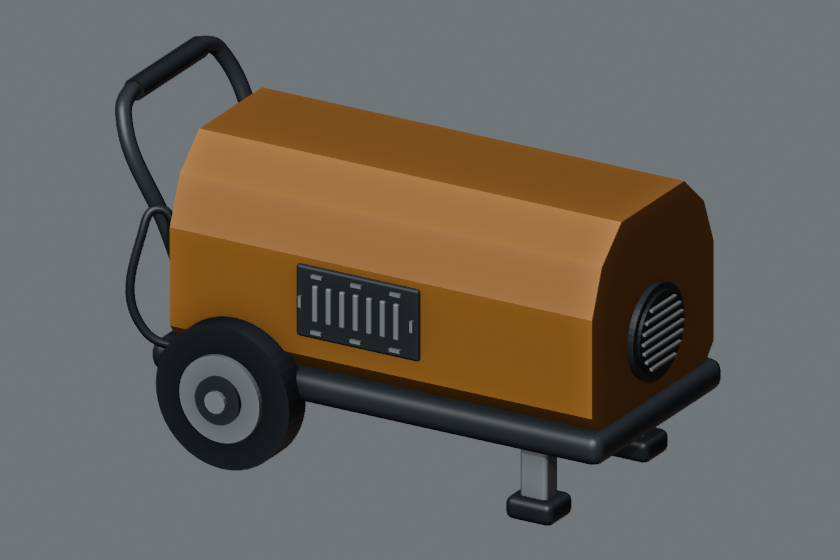
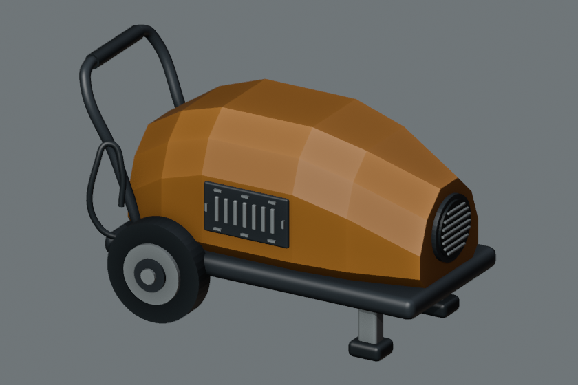
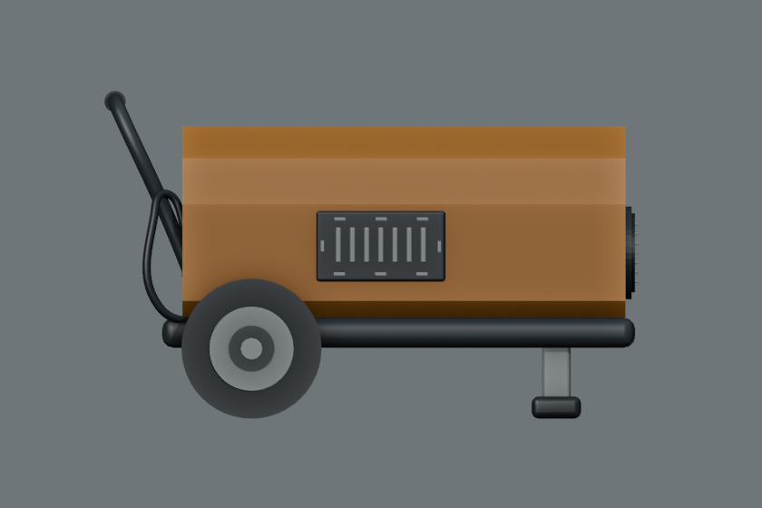
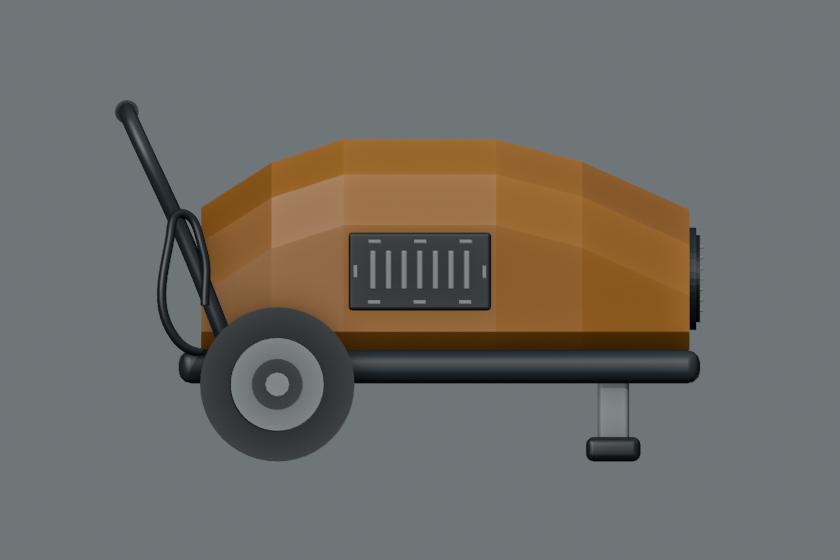

# Forming a portable compressor shroud

An original low-poly industrial exterior provides a focused test of the section helper. The brief calls for a raised central crown over a flat service panel, a narrower, lower intake end, and a rear shoulder that falls away from the tow grip. Dimensions are relative design units. This is a controlled construction study with builder self-review and independent reproduction. A separate blind task is needed to test whether a workflow improves an independent builder's output.

| Straight chamfered extrusion | Six corresponding sections |
| --- | --- |
|  |  |
|  |  |

In the side view the extrusion carries the crown height all the way to both ends. The loft holds the short plateau directly above the service panel and reaches the intake grille through two descending roof planes. In the three-quarter view the narrower intake exposes the lip of the undertray. The lower rear shoulder opens up the space inside the tow handle. The exposed grille, vents and clips are unchanged. The rings intentionally remain faceted. [Cross-section overlay](section-loft/sections.svg)

## Controlled changes

Both variants use the same local-to-world mapping, ten named-by-order corners on each section, end locations, central width and central height. The input variable is the longitudinal arrangement of those sections. The remainder of the fixture shares one builder function. This includes a beveled tray, wheels, feet, tow handle, service hose, intake grille, and the side-cover clips placed by cumulative perimeter distance. Workbench camera, frame scale, shading and object colors match within each pair. The exercise tests the hood geometry. The shared clips demonstrate how to consume a path tangent, with no separate claim of improvement to the clip layout.

| Landmark in the saved mesh | Straight extrusion | Loft |
| --- | ---: | ---: |
| Intake end, width × top elevation | 1.24 × 1.65 | 0.86 × 1.29 |
| Grip end, width × top elevation | 1.24 × 1.65 | 0.92 × 1.30 |
| Central maximum, width × top elevation | 1.24 × 1.65 | 1.24 × 1.65 |

The first loft scaled each corner independently with the local width and height. This changed the direction of diagonal section edges and introduced a diagonal shading break in the cheeks. Keeping the bevel offsets fixed preserves parallel edges between sections and removes the intra-panel diagonal. The test now compares both stored triangle normals across each intended planar cheek. The final camera also leaves more room around the handle. [First loft before the cheek repair](section-loft/first-loft.png)

## Reproduce

From the repository root, use the chosen Blender executable and an empty output directory. The fixture creates, saves, reopens and inspects both models. The optional render flag produces the four final Workbench PNGs. The test checks the actual saved shroud's finite design landmarks, contiguous manifold edges, positive signed volume, nonzero face areas and matching normals across the planar face diagonals. Python-only tests exercise invalid rings, station order, SVG-to-mesh agreement, exact-corner tangent choice and seam wrapping.

```sh
blender -b --factory-startup --python-exit-code 1 --python tests/section_loft_scene.py -- runs/compressor-sections --render
BLENDER=/path/to/blender python3 -m unittest discover -s tests -p 'test_section_loft*.py' -v
```

The seven focused tests passed with Blender 4.5.16 LTS on macOS. Inspection covered the native saved shrouds and the rendered views above. The fixture contains original procedural meshes and curves. It uses no imported assets, traced profiles, reference photos or private source. The method applies to a sequence of parallel convex sections with deliberate vertex correspondence. Concave caps, openings, arbitrary three-dimensional sweeps, exported topology and comparison to a manufactured product are outside this experiment.

An independent reviewer rebuilt the fixture and reproduced the four published final PNG hashes. They measured the six stations in the reopened model and confirmed the same 42 other object names in both variants. Their visual review confirmed the exposed front tray lip, the two front roof slopes and the additional space inside the rear grip.

The native source hashes for the published final views are `22d0c85bd43e61946bffaabbeccf2a273443954eeec415debcd5c22f88f266ee` (before) and `9d352820fd2ff20b5162e27370b77be6e7bff542a1048bc412317eab7c071bea` (after). They identify this render run. Regenerated Blender files can have different bytes.

[Fixture](../../tests/section_loft_scene.py) · [Reusable reference](../../skills/blender-asset-workflow/references/parametric-surfaces.md) · [Implementation](../../skills/blender-asset-workflow/scripts/section_loft.py)
