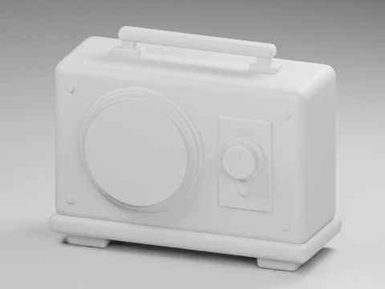
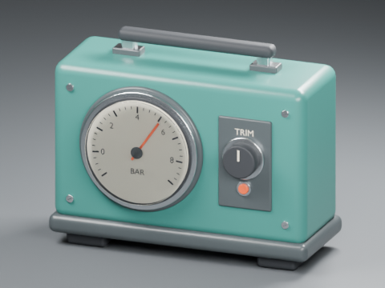

# Bench gauge surface and GLB transfer

An original static bench pressure gauge tests whether a colored material pass can travel with the asset. The enamel housing, turned bezel, rubber feet and grip, thin glass over the needle, and two polished catch faces give each material a specific job. The fixture generates its geometry and materials locally with Blender primitives and built-in text. The experiment uses no source model, supplied texture or downloaded environment.

| Gray geometry check | Colored native asset | Actual GLB reimport |
|---|---|---|
|  |  |  |

The gray view shows the handle, feet, housing edge and concentric bezel. Its opaque override covers the dial. With color restored, the bright bezel separates from the black gasket, the orange needle separates from the dial and the reflection on the top edge describes the housing radius. The final fixture also smooths the bevel normals and removes a separate seam strip whose corners protruded through the shell. An independent visual review of the corrected six renders confirmed the two upper-edge protrusions had disappeared, the bevel reflection was continuous and both imported images looked close to the smooth native preview. The two contact patches occupy little space in this view. Their assignment survived export; a visual improvement from wear alone would need a closer shot or a separate wear-off control.

## What survived the file

The exporter received the asset meshes from the source scene. The script imported the actual GLB into a new empty scene and then substituted its objects into the existing review stage. Both exports contained 72 mesh nodes, eight materials, and two catches with distinct painted and metal primitives. The test checked the four surface roles' base colors, metallic and roughness factors, and the glass extensions for transmission 1 and IOR 1.48. The extension values establish which glass properties were encoded. The visible dial verifies legibility under this light and camera.

| Native grain stress test | Reimport of the same grain asset |
|---|---|
|  |  |

The deliberately coarse bump broke up the long highlight and introduced conspicuous mottling across the top and front. Its GLB contained zero image textures, and the two imported versions rendered identically in this run. Use the simple colored material for this asset. An explicitly textured surface would require a baked or authored map and a new comparison. Baking, multilayer glass, transmission in another engine and visual equivalence under other lighting remain untested.

The [raw metrics](presentation-transfer/metrics.json) use the decoded display PNG channel values on a 0–255 scale. Mean error averages all RGB channels and the whole frame, including the floor. The pixel fraction counts pixels with a change greater than eight in any channel. These are observations for this gauge and camera.

| Image pair | Mean absolute RGB difference (8-bit levels) | Pixels over 8 in any channel |
|---|---:|---:|
| Simple native → simple GLB | 0.0498 | 0.018% |
| Grain native → grain GLB | 0.8643 | 2.325% |
| Simple → grain, native | 0.8396 | 2.306% |
| Simple → grain, after GLB import | 0.0 | 0.000% |

## Framing, preview and final

The [first render](presentation-transfer/00-clipped-initial.png) clipped the grip and feet. The camera had been fitted with the source scene's stale evaluation context. The corrected helper evaluates the presentation view layer explicitly. The fixture now projects each mesh bounding-box corner through the presentation camera and checks its inset from all four edges. Early exports using selection alone also duplicated a selected grip mount from the second scene. Restricting the export to the active source scene as well as the selected assets corrected the node count.

The final comparison used Blender 4.5.16 LTS, Cycles CPU, four threads, a fixed seed of 29 and denoising. The stage used an orthographic camera looking from direction (1, −2.65, 0.98), three rectangular area lights, a gray world and a floor. AgX, sRGB display, look None, exposure −1.15 and gamma 1 were held constant across all five comparison frames. Exposure was selected once for this gauge.

The 480 × 360 preview used 24 samples. The [1200 × 900 native final](presentation-transfer/06-final-native.png) used 96 samples to inspect the small dial graduations and markings at delivery size. The controlled image error figures come from the preview-sized, matched native and GLB pairs.

## Reproduce

Run this from the repository root with a new or empty output directory and a Blender executable on PATH. The fixture writes the actual two GLBs, comparison PNGs, metrics JSON and, with the optional final flag, the native high-resolution PNG.

```sh
blender -b --factory-startup -t 4 --python-exit-code 1 \
  --python tests/surface_fixture.py -- /path/to/empty-output --final
```

The [fixture](../../tests/surface_fixture.py) builds the gauge and measures the decoded images. The [unit and Blender integration tests](../../tests/test_surface_studio.py) exercise override validation and compare the portable and lost-procedural results with tolerances for rendering variation. The [skill reference](../../skills/blender-asset-workflow/references/surface-presentation.md) gives the reusable procedure.
