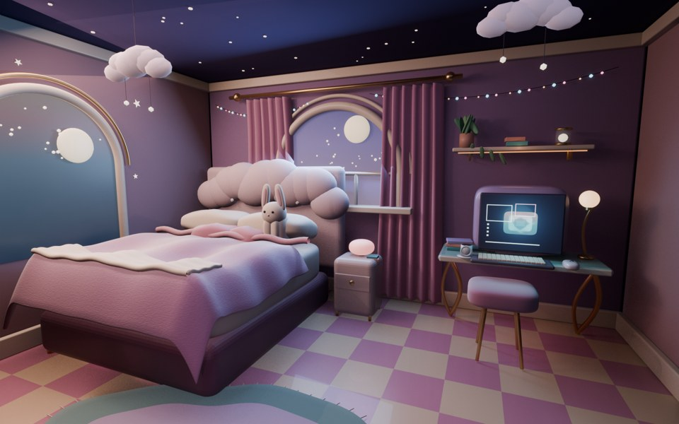

# 梦核卧室：三组 DSH 实验

三组配置使用同一段卧室需求正文。A 不具备 DSH Blender 桥工具，因此移除了原有强制用桥前缀；B、C 保留前缀。A、C 各完整运行一次，B 中断后追加指令续接并改变了渲染条件。结果用于观察配置和运行过程，不能证明统计优劣或单独归因。工作流成因与改进方案见 [实验报告](REPORT.md)，校验值见[证据清单](results/evidence-manifest.json)。

本 PR 已验证 C 的“第三方桥工具＋我们的 skill”能完成本案例，替代插件自带建模 skill。A 有实际独立审阅调用，C 仅声明自查，不能把较短过程直接解释成 QA 打转已修复；桥、隔离效果、QA 差异与最终图对比在报告中分别呈现。

已记录 token：A 主会话至少 54,997,308，另有独立 reviewer 6,070,972，合计至少 61,068,280；B 中断前与续接合计 10,728,014；C 为 15,548,529。缓存读取占主要部分。缺失重试用量、统计范围及可比性见[报告中的 token 统计](REPORT.md)与[原始计数摘要](results/token-usage.json)，不能按调用次数或统一 token 单价推算费用。

## A：DSH + 我们的 skill，无 DSH Blender 插件

- DSH 0.2.1-rc.5；Blender 5.2.2 LTS；无 `dsh-blender-plugin`。同一 skill 快照的哈希与 C 组相同；正式运行调用了我们的 `blender-asset-workflow`。实际模型 ID 和采样参数未记录。
- 正常退出，耗时 83 分 39 秒，271 次工具调用：`bash` 172、`read_image` 64，其余见 [脱敏调用顺序](results/arm-a-trace-summary.json)。没有 `blender_rt_*` 调用；模型通过后台 Blender 脚本建模、渲染和检查。
- Blender 启动日志显示本机已有 BlenderMCP 扩展被注册；没有证据表明 DSH 调用了它。这里的“无桥”指 DSH 配置未安装本次比较的桥插件，且事件流未记录桥工具调用，不代表主机没有任何 Blender 扩展。
- DSH 报告独立审阅及最终定向复核通过；该报告是本次运行自己的结果。另行只读画面审阅未见明确的大面积穿模或破面，床品边缘和床脚灯带较生硬；静帧不能证明遮挡处不存在几何相交。本次未对 A 组应用与 C 组相同的指定对象相交检查。

## B：DSH + 未修改的完整第三方插件 + 我们的 skill 可用

- DSH 0.2.1-rc.5；未修改的 dsh-blender-plugin 3.0.4；Blender 5.2.2 LTS。预检确认插件自带 skill 与我们的 skill 均可被发现；正式运行在中断前调用了插件自带的 `blender-modeling`，没有记录到调用我们的 skill。实际模型 ID 和采样参数未记录。
- **本次运行因系统重启中断，不能作为完整的 B 组结果。** 14:21:38 开始，最后一条事件记录于 14:51:16；没有正常结束事件或最终主图。[脱敏调用顺序](results/arm-b-interrupted-trace-summary.json) 记录了中断前的 75 次工具调用。14:48:32 保存的 `.blend` 与更早的测试图仍在本机，但后者不能当作最终成图。
- 渲染主图的 worker 调用超时后，插件仍报告 worker 存活，随后 DSH 启动了另一项独立渲染作业；没有证据证明第一项已经结束，也无法证明两项确实同时渲染。该过程可能增加资源压力，但现有证据不足以确定卡死原因。系统采样在 14:50 显示约 12.7 GiB 可用内存、交换分区几乎未使用；采样间隔为十分钟，不能排除之后的瞬时峰值。持久日志中未发现明确的 OOM 或 GPU 故障记录。
- 用户随后要求续接。已备份中断时的会话和场景，并在原会话追加恢复指令，要求单任务渲染、禁用实时光追及最多 64 采样；续接服务设置了 12 GiB 内存和约 8 核 CPU 上限，并采样可用内存及 NVIDIA 显存。续接正常退出，产生 1000×620 主图和更新后的场景；10 次工具调用见[续接轨迹摘要](results/arm-b-resumed-trace-summary.json)。续接增加了提示词并改变渲染与资源配置，不能作为无中断、原条件的 B 组完成结果。
- 续接过程中先后完成两次渲染：第一次成图后，DSH 更新了场景中已打包的海报图片，再渲染并保存。38 次系统采样最低可用内存约 21.8 GiB，NVIDIA 显存最高记录 18 MiB；采样不证明所有 GPU 或瞬时峰值情况。独立静图审阅认为画面可作候选展示，但墙面、窗帘和地毯有明显颗粒，窗外偏亮，顶部球灯被裁切；未以此推断几何碰撞检查结果。

## C：DSH + 插件桥工具 + 我们的 skill，插件自带 skill 已关闭

- DSH 0.2.1-rc.5；dsh-blender-plugin 3.0.4 的隔离副本；Blender 5.2.2 LTS。DeepSeek provider 的实际模型 ID、采样参数未记录。
- 预检在单独会话确认我们的 skill 与 `blender-modeling` 禁用空壳都可加载；正式运行实际仅调用了我们的 `blender-asset-workflow`。原版插件被复制后，只在副本的 `lib/plugin.js` 停用 `registerBundledSkill(ctx)`；其他插件工具仍存在。这不是自研桥，也不代表只有单一桥工具。
- 正常退出，126 次工具调用；其中 `blender_rt_cmd` 54、`blender_rt_do` 10、`blender_rt_see` 17。运行约 30 分 27 秒，按本机事件文件创建与结束时间估算。完整原始事件流只保存在本机；[脱敏调用顺序](results/arm-c-trace-summary.json) 包含原始流 SHA-256。
- 模型做了自查，报告了保存和重新打开场景；插件的无头 `audit_scene` 因 `__file__` 未定义而失败，不能记为通过。后续只读网格检查确认两侧窗帘与窗框、外饰线和横档相交，兔子与右侧枕头相交，多个枕头之间也有相交。B／A 未使用相同的几何碰撞检测，因此不能把这些缺陷数量用于横向排名。
- [指定对象的表面检查](results/arm-c-selected-surfaces.json)绑定到最终场景哈希，包含曲线的求值网格；16 个配对中 15 个检出严格表面穿越。该数字不是独立视觉缺陷数量，也不表示穿透深度；方法与限制见[脚本](audit_selected_surfaces.py)。[工作流证据](results/arm-c-workflow-evidence.json)记录了兔子移动、枕头重建、审计失败和最终自查实际覆盖范围。

## 历史数据，不计入三组

- 原始报告：Blender 4.5.3 LTS，约 67 分钟、201 次调用；完整原始事件流未随 PR 提供，无法独立复核，历史 [成图](results/beauty_960.jpg) 保留。
- 本机早期再跑：Blender 5.2.2，约 34 分钟、95 次调用；[脱敏调用顺序](results/historical-rerun-trace-summary.json)。它实际调用的是插件内置 `blender-modeling`，而非预期的空壳。由于无法证明我们的 skill 当时可被发现，不作为完整 B 组；[成图](results/rerun_hero_960.jpg) 保留。

## 许可与分发

插件通过 npm 安装，不随仓库分发。上游将插件主体标为 BSD-3-Clause，将插件自带 `blender-modeling` skill 标为 MIT，参见 [第三方项目](https://github.com/sixtysevenlf/dsh-blender-plugin) 的 LICENSE 及该 skill 的 LICENSE／NOTICE。若以后分发插件或其 skill 的代码、修改版本或其他第三方材料，须分别保留适用的版权、许可和免责声明，并核对依赖及素材的许可。本仓库内容的许可范围见 [LICENSING.md](../../LICENSING.md)。

用于展示的缩略图为对应本机生成结果的缩放副本；模型源文件和包含本机路径、生成代码等内容的原始轨迹未提交。各组最终实际加载情况应以其独立会话的事件结果为准，不以文件存在或预检结果代替。
